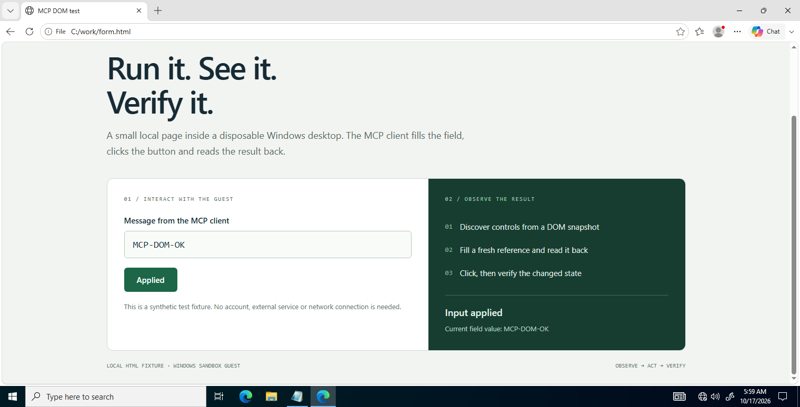

<div align="center">

<h1>Windows Sandbox MCP</h1>
<p><strong>Give your coding agent a disposable Windows desktop.</strong></p>
<p>Run commands. Inspect controls. Click, type, and verify the result.</p>

<p>
  <a href="https://github.com/xxmisaoxx/windows-sandbox-mcp/actions/workflows/ci.yml"></a>
  <a href="LICENSE"></a>
  <a href="#quick-start"></a>
  <a href="#18-tools-one-desktop-workflow"></a>
</p>

<p><a href="#quick-start">Get started</a> · <a href="#connect-your-agent">Connect your agent</a> · <a href="#see-it-working">Real demo</a> · <a href="docs/GUI-AUTOMATION.md">GUI guide</a> · <a href="CONTRIBUTING.md">Contribute</a></p>

</div>

Let **Codex, OpenCode, and other local MCP clients** work inside Windows Sandbox:
run test commands, interact with desktop applications, automate compatible browser
pages, and bring screenshots and files back to the agent.

- **Run Windows commands** with stdout, stderr, exit codes, and timeouts.
- **Use the desktop** with native control inspection, mouse input, Unicode text, and shortcuts.
- **Work with browser forms** through optional guest-local DOM snapshots and actions.
- **Verify what happened** with fresh observations, PNG screenshots, and hashed artifacts.

**Tested on Windows 10 Pro 22H2 x64.** Windows 11 support is being evaluated;
it is not yet certified. [Compatibility details →](docs/WINDOWS11-COMPATIBILITY.md)

## See it working

<p align="center">
  <a href="docs/assets/desktop-demo.png"></a>
</p>

**An actual MCP run, using a synthetic offline page.** The client discovers a
field, fills it with `MCP-DOM-OK`, reads the value back, clicks **Apply**, and
verifies the changed button state before retrieving the screenshot. No account
or external web service is involved. [Capture details](docs/assets/demo.json).

Reproduce this demo after installation, with no other Sandbox open:

```powershell
.venv\Scripts\python.exe scripts\check-mcp-live.py
```

The runner also checks guest commands, binary transfer, native UIA3 inspection,
CDP opt-in enforcement, and native MCP image/resource retrieval. It closes its
Sandbox when finished. The page is included in [examples/browser-demo.html](examples/browser-demo.html).

## Quick start

You need **Windows 10 Pro 22H2 x64**, an interactive desktop, Windows Sandbox
and virtualization enabled, **Git**, **Python 3.11+**, and [uv](https://docs.astral.sh/uv/getting-started/installation/).
Run the server as a normal user. Close any manually opened Sandbox first.

```powershell
git clone https://github.com/xxmisaoxx/windows-sandbox-mcp.git
cd windows-sandbox-mcp
uv sync --frozen
.venv\Scripts\python.exe -m winsandbox_mcp --doctor
```

This installs from source using the committed dependency lock. The doctor
command reports host prerequisites; installation alone does not start a Sandbox.
Next, connect your agent below. [Full setup and troubleshooting →](docs/SETUP.md)

## Connect your agent

### OpenCode

From the repository directory:

```powershell
.venv\Scripts\python.exe scripts\install-opencode.py
opencode mcp list
```

The helper adds `windows_sandbox`, preserves other OpenCode settings, and backs
up an existing config before changing it. Restart an existing OpenCode session
to load the tools. [Manual configuration](docs/SETUP.md#opencode-installed-1151).

### Codex

Generate a configuration with the absolute paths of your checkout:

```powershell
.venv\Scripts\python.exe scripts\client-configs.py
Get-Content .runtime\client-configs\codex-config.toml
```

Copy the generated `[mcp_servers.windows_sandbox]` entry into your
`~/.codex/config.toml`, preserving your existing settings. Reload Codex and check
the server in `/mcp`. [Configuration details](docs/SETUP.md#codex-installed-cli-01630-alpha102).

### Your first task

Ask your agent:

> Use the windows_sandbox MCP to start a Sandbox, run a command that prints the
> Windows version, open Notepad, and type “Hello from my agent”. Read the text
> back to verify it, retrieve and show me a screenshot, then stop the Sandbox.
> Keep application execution and desktop interaction inside the guest.

The MCP server stays local and speaks stdio. Your agent's usual permissions and
model access still apply. You do not need a separate API key for this server.

## 18 tools, one desktop workflow

**Observe → act → observe again.** A successful input call means input was
submitted; a fresh inspection or screenshot verifies the application result.

| Workflow | Tools |
|---|---|
| Create and recover a desktop | `sandbox_doctor`, `sandbox_start`, `sandbox_status`, `sandbox_restart`, `sandbox_stop` |
| Run commands and launch apps | `sandbox_exec`, `sandbox_launch` |
| Inspect and operate native apps | `sandbox_windows`, `sandbox_inspect`, `sandbox_click`, `sandbox_text`, `sandbox_keys` |
| Work with compatible web pages | `sandbox_browser` |
| Transfer files | `sandbox_upload`, `sandbox_download` |
| Capture and retrieve evidence | `sandbox_screenshot`, `sandbox_artifact`, `sandbox_collect_evidence` |

Native inspection supports UIA3, managed UIA2, MSAA with optional IA2-role
queries, and Win32 controls. Inspection runs in a killable guest worker so a
stuck provider can time out without hanging the main agent.

For Chromium/Electron, `sandbox_launch(accessibility=true)` enables the renderer
accessibility flag on a fresh launch. Opt into a guest debug port to use
`sandbox_browser` for DOM snapshots, fill, and click. This backend covers ordinary
main-frame DOM; Firefox, closed shadow roots, canvas, and cross-origin frames
need another path. [GUI examples and limits →](docs/GUI-AUTOMATION.md)

## Tested beyond the happy path

| Verification | Recorded result |
|---|---|
| Automated tests on Windows 10 | **89 passed**, 1 skipped for unavailable symlink privilege |
| Live Windows Sandbox integration | **13 steps passed**, including crash recovery and restart |
| Real MCP stdio client | Commands, native GUI inspection, DOM actions, file transfer, PNG images, and binary resources passed |
| Client connections | Codex discovered all 18 tools; OpenCode connected |
| Hung accessibility provider | Worker terminated; the guest agent remained usable |

These are recorded runs on the documented Windows 10 machine, not a guarantee
for every Windows build or application. GitHub Actions runs unit/protocol,
lint, helper compilation, and packaging checks; it does not start a real Sandbox.
[Reproduce the checks and inspect the measurements →](docs/VALIDATION.md)

## Isolation you can inspect

The host uses the official Python MCP SDK. The guest uses built-in Windows
PowerShell 5.1, .NET Framework, Win32, and UI Automation. GUI observation and
input happen inside the guest. There is no host desktop automation fallback.

| Default | Behavior |
|---|---|
| Networking and redirection | Networking, vGPU, clipboard, printer, audio input, and video input disabled |
| Host folder exposure | Only generated read-only inbox and dedicated writable outbox mapped |
| Communication | Bounded JSON mailbox; no host bridge listener or guest-to-host execution dispatcher |
| Guest runtime | No host Python mapping or runtime guest package downloads |
| Artifacts | Host-owned copies with SHA-256 metadata; files limited to 4 MiB per transfer |

**Early development.** One Sandbox per interactive Windows session. The writable
outbox has no enforced disk quota and can fill its host volume; use quota-limited
disposable storage for hostile workloads. Opting into networking permits normal
host/LAN access. Stopping the guest discards its disk, while host artifacts and
retained requests remain. Some longer test sessions showed increased latency.
Read the [security model](SECURITY.md), [audit](docs/AUDIT.md), and
[architecture](docs/ARCHITECTURE.md) before running untrusted workloads.

## Help shape the next version

The next priorities are Windows 11 lifecycle support, portable GUI fixtures,
and better performance in long sessions. Reproducible reports and focused fixes
are welcome. [Contributing](CONTRIBUTING.md) · [Report a bug](https://github.com/xxmisaoxx/windows-sandbox-mcp/issues/new?template=bug_report.md) · [Request a feature](https://github.com/xxmisaoxx/windows-sandbox-mcp/issues/new?template=feature_request.md)

If a disposable Windows desktop would help your agent, **star the repo to
follow its progress**. Try the demo and tell us what you want to automate next.

Released under the [MIT license](LICENSE).
